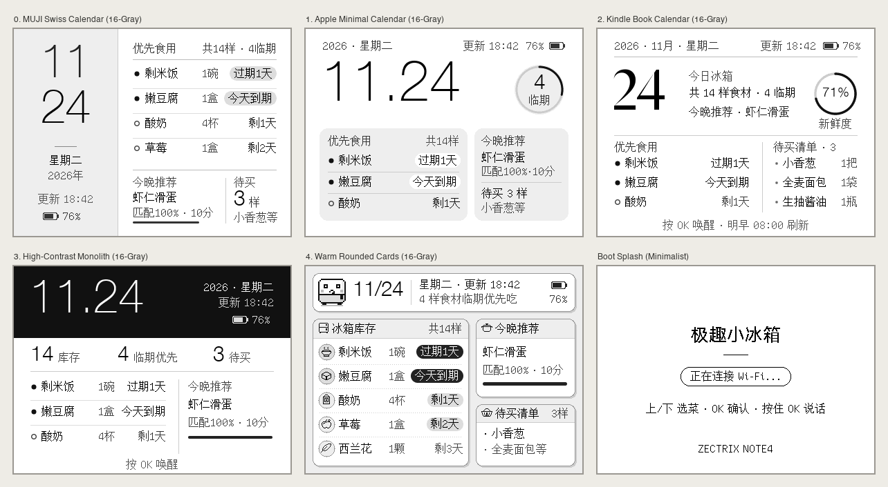
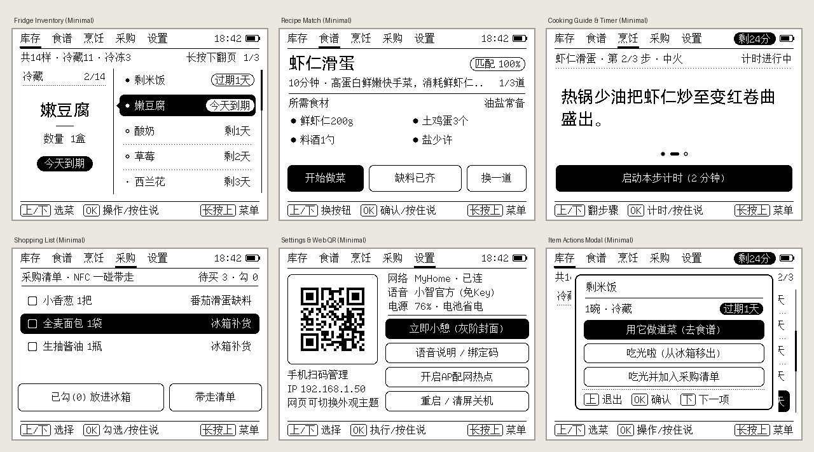
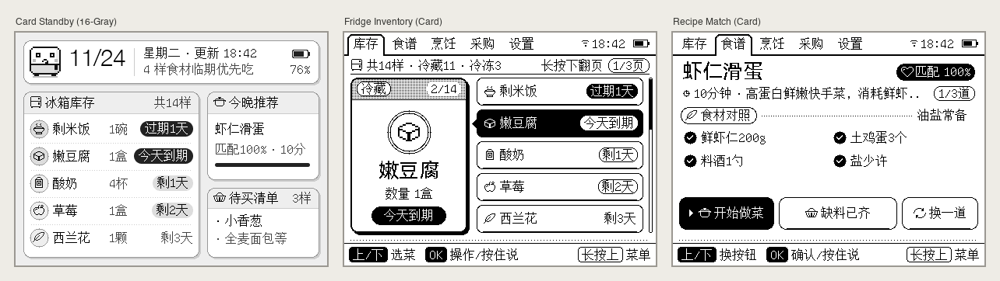

# 极趣小冰箱 · ZECTRIX NOTE4 墨水屏智能冰箱管家

面向 **ZECTRIX NOTE4**（ESP32-S3 · 4.2 寸 `400×300` 黑白 / 真 16 灰阶电子墨水屏）的开源智能冰箱管理固件，基于 **ESP-IDF v5.5** 开发，完整集成 **冰箱库存管理、临期预警与菜谱推荐、大字烹饪引导、NFC/二维码购物清单带走、手机网页双主题换肤** 与 **免 API Key 小智语音助手（设备端 MCP）**。

> **只想直接体验刷机？** 可直接在本仓库右侧 **[Releases](../../releases)**（或独立固件发布仓 [zectrix-fridge-firmware](https://github.com/wuyinyuanye/zectrix-fridge-firmware)）下载脱敏预编译 `.bin` 固件，免编译一键烧录。

---

## 界面实机像素预览

### 5 套 16 灰阶（4bpp）抗锯齿待机封面 & 开机页


### 极简高级风（全机交互页与弹窗同步）


### 温馨圆角卡片风（待机与内页同步）


---

## 核心特性

- **全机双主题同步换肤（手机网页一键切换，立即全刷生效）**
  - **极简高级风**（默认）：MUJI / Apple / Kindle 视觉体系，大留白、细线下划线页签与瑞士网格排版，从待机封面到交互内页与弹窗风格完全统一。
  - **温馨圆角卡片风**：内置 13 套手绘像素食材图标与圆角卡片质感，配套精修 16 灰阶卡片待机海报。
- **5 套真 16 灰阶（4bpp）抗锯齿待机封面 & 3 分钟防残影自动休眠**
  - 全部采用**大号抗锯齿日期主角 + 均衡黑白灰层级 + 小字更新时间戳**（每天早起自动唤醒刷新一次，全天准确且极致省电）；
  - 电池供电时无操作 **3 分钟**自动全刷回到 16 灰阶待机封面并进入深睡（彻底停止局刷）；唤醒交互期间右上角时间每分钟静默局刷，并收紧全刷阈值（每 5~6 次局刷自动清残影），避免墨水屏泛灰变脏；
  - 手机网页「设置」可随时切换：`MUJI 瑞士双栏日历`、`Apple 极简大日历`、`Kindle 单向历书页`、`原研哉 黑白撞色海报`、`温馨圆角卡片看板`。
- **库存管理 + 长按下键整页连翻**
  - 支持最多 **80 样**食材；绝不编造保质期（未设到期天数时如实显示「今天放入 / 已放 N 天」）；
  - 左焦大卡 + 右列 5 项清单，食材超过 5 样时**按住下键连续整页翻页**、松手即停。
- **今日食谱 & 29px 原生大字烹饪引导**
  - 实时比对冰箱库存并优先消耗临期食材，支持缺料一键加入采购清单；
  - 烹饪页使用 29px 大字步骤引导，内置厨房倒计时（仅局部静默刷新右上角胶囊，不闪全屏，到点响铃并可语音播报）。
- **采购清单带走：NFC 一碰直达 + 二维码兜底 + 一键排版购物卡**
  - 联网后自动将本机采购页写入板载 NT3H NFC 标签并立即断电省电；iPhone / Android 轻碰直达采购清单；
  - 兼容无 NFC 硬件批次与离线场景：「带走清单」自动弹出二维码（离线自动降级为纯文本清单码）；
  - 手机网页内置**一键生成排版购物卡 PNG 图片**（存相册进超市断网可看）与**一键复制清单**。
- **免 API Key 小智语音助手（纯设备端 MCP，9 个内置工具）**
  - 按住 `OK` 键听「叮」后自然说中文（例如：“放两盒牛奶 5 天过期，排骨放冷冻”、“番茄吃完了，顺手把小葱加采购单”、“定时 15 分钟”、“用冰箱里的菜推荐一道快手菜”），支持语音回复播报与一键撤销；
  - 默认直连公开免费小智云端（`xiaozhi.me`，0 充值、0 Key），亦可在网页设置中一行改连自家局域网私有小智服务（无需改动服务端）；
  - 通过标准 MCP JSON-RPC 2.0 暴露 9 个设备端工具：`fridge_get_inventory`、`fridge_add_item`、`fridge_set_expiry`、`fridge_remove_item`、`fridge_add_shopping`、`fridge_start_timer`、`fridge_stop_timers`、`fridge_set_recipe`、`fridge_cook_step`。

---

## 实体三键速查

| 场景 | `上键` | `下键` | `OK 键` |
| :--- | :--- | :--- | :--- |
| **顶部菜单栏**（页签反黑） | 上一个页面 | 下一个页面 | 进入当前页面 |
| **页面内部** | 上一项（到顶回菜单）；**长按 0.6 秒**回菜单 | 下一项；多页列表**长按连续整页翻页** | 确认 / 弹窗 / 勾选 |
| **任意界面** | 弹窗内一键退出（语音结果页可一键撤销） | **长按 3 秒**进入 16 灰阶待机小憩 | **按住 0.35 秒**听「叮」后语音对话 |
| **深度小憩休眠中** | — | 短按唤醒 | 短按唤醒 |

---

## 快速体验：刷入预编译固件

> **重要提醒**：刷机前强烈建议先用 `esptool` 备份原厂完整 16MB Flash，以便随时无损恢复原厂系统：
> ```bash
> esptool.py --chip esp32s3 -p <你的串口> -b 460800 read_flash 0x0 0x1000000 note4-factory-backup-16mb.bin
> ```

前往 **[Releases](../../releases)** 下载最新固件（以 `v0.0.3` 为例）：

- **首次全新刷入（推荐）**，写入合并包到 `0x0`：
  ```bash
  esptool.py --chip esp32s3 -p <你的串口> -b 460800 \
    --before default_reset --after hard_reset \
    write_flash --flash_mode dio --flash_size 16MB --flash_freq 80m \
    0x0 zectrix-fridge-v0.0.3-merged-0x0.bin
  ```
- **老版本无损升级**（保留冰箱库存、菜谱与 Wi-Fi 配置），写入主程序到 `0x20000`：
  ```bash
  esptool.py --chip esp32s3 -p <你的串口> -b 460800 \
    --before default_reset --after hard_reset \
    write_flash --flash_mode dio --flash_size 16MB --flash_freq 80m \
    0x20000 zectrix-fridge-v0.0.3-app-0x20000.bin
  ```
- **首次配网**：开机未配置 Wi-Fi 时自动开启专属热点 `ZecTrix-Fridge`（每台设备随机生成独立 8 位密码，显示在「设置」页及二维码中）；连上后浏览器访问 `http://192.168.4.1/` 即可配置家庭 2.4GHz Wi-Fi、管理库存与切换主题/待机海报。

---

## 从源码编译（ESP-IDF v5.5+）

### 1. 准备环境
- 硬件：**ZECTRIX NOTE4**（黑白版 ESP32-S3，16MB Flash / 8MB PSRAM，不兼容 NOTE4C）
- 工具链：**ESP-IDF v5.5.x**（已在 v5.5.4 验证）

### 2. 提取点阵中文字库（必需）
界面使用的 17px 正文与 29px 标题中文点阵字库提取自原厂 3.7.5 固件，出于授权原因不随源码仓库分发。请使用你自己设备的原厂 3.7.5 备份镜像生成：

```bash
python3 tools/extract_official_375_fonts.py \
  --firmware <official_3.7.5.bin> \
  --out-dir main/assets
```

生成的 `main/assets/official_font_17.bin` 与 `main/assets/official_font_29.bin` 已被 `.gitignore` 忽略；若缺少字库，`idf.py build` 会直接提示此命令。

### 3. 本地默认 Wi-Fi 配置（可选）
如需刷机后自动连入指定 Wi-Fi，可复制模板文件并填入配置（该文件已在 `.gitignore` 中，不会被提交）：

```bash
cp main/local_secrets.h.example main/local_secrets.h
```

不创建也可以正常编译，首次开机将自动进入 AP 热点扫码配网。

### 4. 编译、烧录与电脑端 UI 预览
```bash
# 编译并烧录到设备
idf.py set-target esp32s3
idf.py build
idf.py -p <你的串口> flash monitor

# 在电脑端离线渲染全部 41 个墨水屏页面预览（PNG 输出至 build/ui_preview/）
IDF_PATH=<你的ESP-IDF路径> tools/ui_preview/run.sh
```

---

## 项目目录概览

```text
├── main/
│   ├── app_main.cc          # 主循环、双层三键导航、深睡/早间唤醒与语音 PTT 流程
│   ├── fridge_ui.cc / .h    # 全机双主题渲染引擎与 5 套 16 灰阶待机封面
│   ├── pixel_canvas.cc / .h # 1bpp/4bpp 抗锯齿绘图形元、像素图标与点阵字库渲染
│   ├── standby_aa_fonts.h   # 4bpp 抗锯齿大日期字形表
│   ├── fridge_store.cc / .h # NVS/SPIFFS 持久化、库存/食谱匹配、计时器与 NFC 同步
│   ├── wifi_web_service.cc  # 内置 HTTP Web 管理台、AP/STA 配网与 REST API
│   ├── web_ui_html.h        # 手机端双主题响应式网页与一键生成购物卡 Canvas
│   ├── xiaozhi_client.cc    # 小智 Opus + WebSocket + 设备端 MCP 协议客户端
│   └── audio_service.cc     # ES8311 录音、TTS 播放与提示音
├── components/              # NOTE4 板级驱动（墨水屏、电池/充电、RTC、NFC、按键等）
├── tools/
│   ├── ui_preview/          # 宿主机 41 场景像素级离线预览渲染器
│   ├── gen_standby_aa_fonts.py
│   └── extract_official_375_fonts.py
└── docs/images/             # 实机像素预览图
```

更多原始板级驱动说明可见 [README_zh.md](README_zh.md) 与 [README_FRIDGE.md](README_FRIDGE.md)。

---

## 致谢与开源协议

- 底层 ESP32-S3 墨水屏驱动、板级硬件驱动（电池、RTC、NFC、ES8311 音频、按键）与自检组件基于 **Zectrix Lab** 提供的 NOTE4 开源参考驱动（MIT License）。
- 本项目整体采用 **MIT License** 开源（详见 [LICENSE](LICENSE)）；第三方组件声明见 [THIRD_PARTY_NOTICES.md](THIRD_PARTY_NOTICES.md)。
